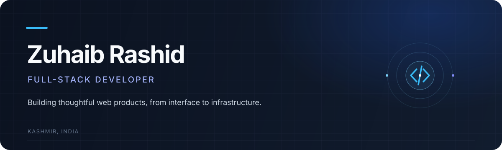

### Full-stack developer · Kashmir, India

I work across product UI and the systems behind it. Lately that has meant healthcare workflows, real-time bookings, and developer tools for understanding what an app is doing.

[Portfolio](https://www.zuhaibrashid.com/) · [LinkedIn](https://www.linkedin.com/in/zuhaib-rashid-661345318/) · [X](https://x.com/xuhaib_x9)

---

## What I work with

  
  
  
  
  
  
  
  
  
  

I also work with TanStack Query, Zustand, Prisma, Docker, and the usual tools that help ship and maintain production apps.

## Selected work

The projects I’m spending the most time on:

<table>
  <tr>
    <td width="50%" valign="top">
      <h3><a href="https://github.com/Zuhaib-dev/HealOS">HealOS ↗</a></h3>
      
A hospital operations platform covering patient records, appointments, staff workflows, and billing. The project is in active development.

      Next.js · React · TypeScript · Express · MongoDB · Socket.IO
    </td>
    <td width="50%" valign="top">
      <h3><a href="https://github.com/Zuhaib-dev/rydex">Rydex ↗</a></h3>
      
A multi-vehicle booking and logistics platform, with live driver matching, trip tracking, and separate rider, partner, and admin workflows.

      Next.js · TypeScript · MongoDB · Redis · Socket.IO
    </td>
  </tr>
  <tr>
    <td width="50%" valign="top">
      <h3><a href="https://github.com/Zuhaib-dev/traceora">Traceora ↗</a></h3>
      
A runtime debugging toolkit that connects UI events, network activity, errors, and backend traces in one view. Includes React, Vite, Express, and Next.js integrations.

      TypeScript · React · Vite · Node.js
    </td>
    <td width="50%" valign="top">
      <h3><a href="https://github.com/Zuhaib-dev/flourish-ui">Flourish UI ↗</a></h3>
      
A UI project I’m building. The repository has the current implementation and project notes.

      UI · Components
    </td>
  </tr>
</table>

## How I like to build

- I like owning a feature end to end: the screen, API, data model, and the edge cases between them.
- I reach for TypeScript, React/Next.js, and Node.js most often; I use MongoDB or PostgreSQL depending on the shape of the data.
- I’m currently working on Traceora and learning more about observability and system design along the way.

## Around the web

[GitHub repositories](https://github.com/Zuhaib-dev?tab=repositories) · [Portfolio](https://www.zuhaibrashid.com/) · [LinkedIn](https://www.linkedin.com/in/zuhaib-rashid-661345318/)

